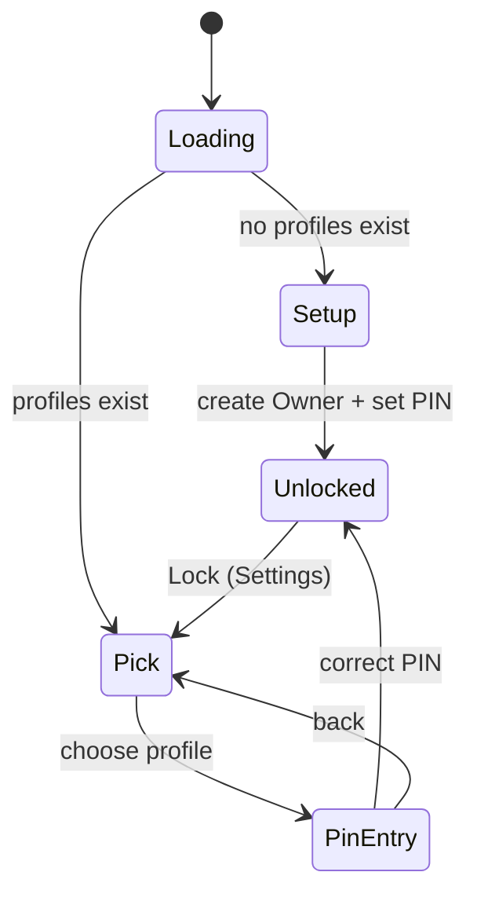
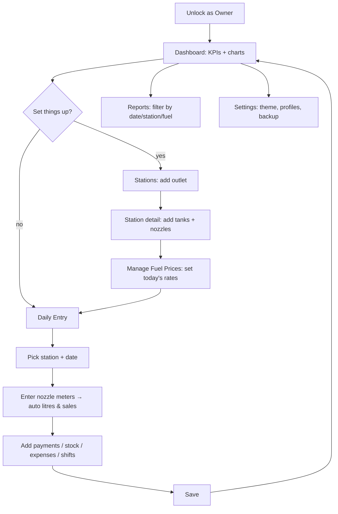
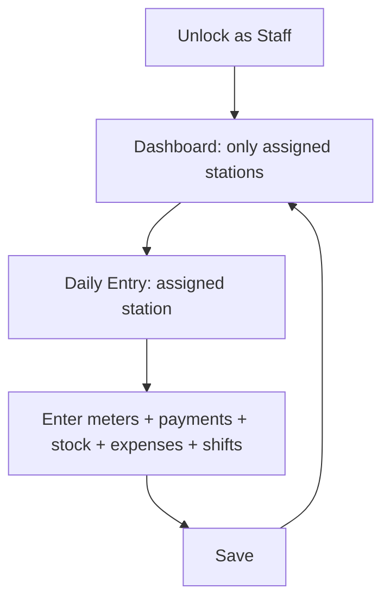
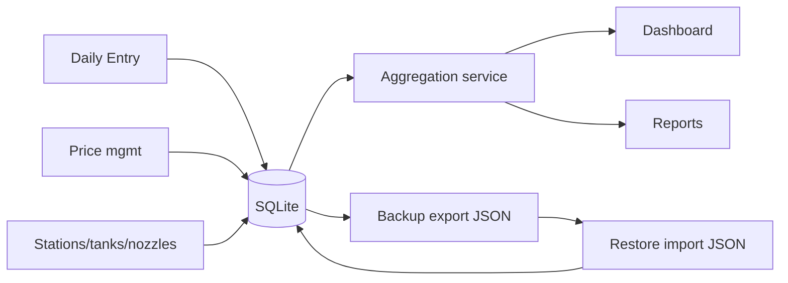

# App Flow

## First launch → unlocked

## Owner daily journey

## Staff daily journey

Staff cannot manage profiles or backups and only see their assigned stations throughout
(Dashboard, Daily Entry, Reports, Stations list).

## Data lifecycle

