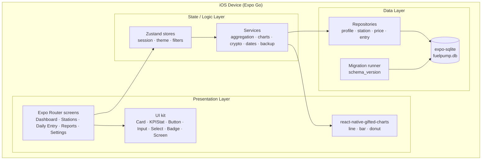
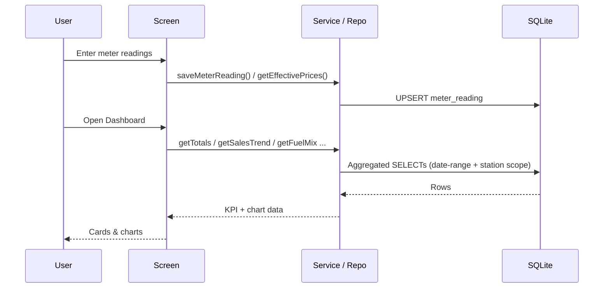
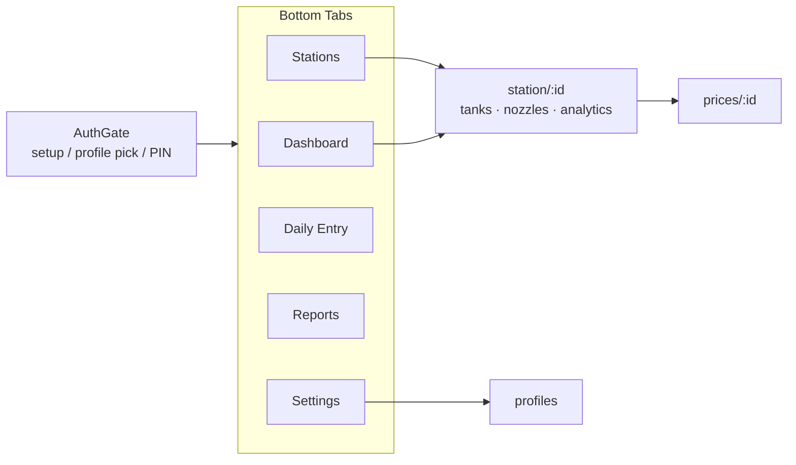

# System Design Architecture (SDA)

FuelPump Manager is a **local-first, single-device iOS app** built with React Native +
Expo. There is no backend: all data is captured and stored on the device in SQLite, and
the app works fully offline. Roles (Owner / Staff) are a local, PIN-gated data-scoping
convention rather than server authentication.

## Layered architecture

## Data flow (core loop)

## Navigation

## Key design decisions

- **Local-only storage.** Chosen per requirements. Roles are enforced by scoping queries
  (`getAccessibleStations`) and a PIN gate, not by a server.
- **Repository pattern.** Each entity group has a repository module; services compose
  repositories for aggregation. This keeps SQL in one layer and makes it unit-testable.
- **Injectable database.** `createInMemoryDatabase()` lets the entire data + service layer
  be unit-tested with real SQL (via a sql.js (WASM) backed `expo-sqlite` mock).
- **Derived analytics.** The dashboard/report numbers are computed on demand from base
  tables (meter readings, payments, expenses, stock movements) — no denormalized caches to
  keep in sync.
- **Backup as the durability story.** Because deleting the app erases the DB, Settings
  provides a JSON export/restore (share sheet + file picker).
