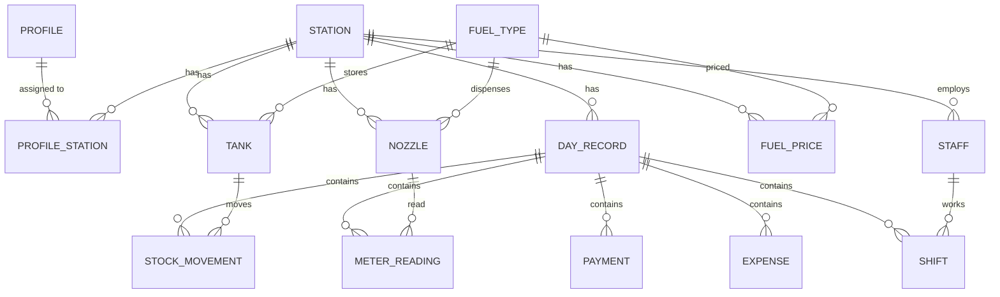

# Database Schema

Local SQLite database `fuelpump.db`. Schema version is tracked in `schema_version`.

## Entity-relationship diagram

## Tables

| Table | Purpose | Notable columns / constraints |
|---|---|---|
| `schema_version` | Migration tracking | `version` PK |
| `profile` | Local user profiles | `role` ∈ {owner, staff}; `pin_hash`, `pin_salt` |
| `profile_station` | Staff → station scope | PK `(profile_id, station_id)`; cascades |
| `station` | Retail outlets | `name`, `location`, `code`, `active` |
| `fuel_type` | Fuel catalog (seeded) | unique `code`; `unit`, `color` |
| `tank` | Storage tanks | `capacity`, `low_threshold`; FK station/fuel_type |
| `nozzle` | Dispensing nozzles | FK station/fuel_type; `tank_id` (SET NULL on tank delete) |
| `fuel_price` | Effective-dated prices | unique `(station, fuel_type, effective_date)` |
| `day_record` | One per station per date | unique `(station_id, date)` |
| `meter_reading` | Per-nozzle readings | `opening`, `closing`, `test_litres`, `price` |
| `stock_movement` | Tank stock events | `type` ∈ {opening, receipt, closing, adjustment} |
| `payment` | Payment split | `method` ∈ {cash, card, upi, credit} |
| `expense` | Daily expenses | `category`, `amount` |
| `staff` | Station staff | `name`, `phone`, `active` |
| `shift` | Staff shift log | `shift` ∈ {morning, evening, night, full} |

## Seed data
Four fuel types are seeded on first migration: **MS** (Petrol), **HSD** (Diesel),
**XP** (Premium), **CNG**. Each has a display color used by charts.

## Derived values (not stored)
- **Litres dispensed** = `max(0, closing − opening − test_litres)` per reading.
- **Sale amount** = litres × price.
- **Stock balance** = running sum of opening/receipt/adjustment, overridden by a recorded
  `closing` count.
- **KPIs / mixes / comparisons** are computed on demand by the aggregation service.
